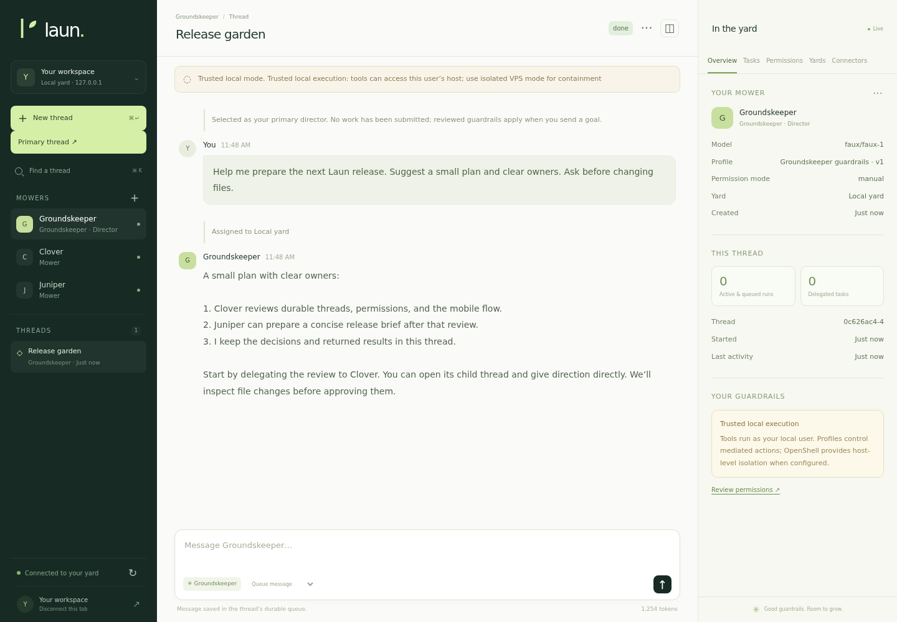

# Laun

A self-hosted workspace for durable agents. Name your **mowers**, keep their
conversations in server-owned **threads**, delegate through a **groundskeeper**,
and run workers in local or VPS **yards**. The app brings tasks, permissions,
MCP tools, and execution hosts into one interface.

[Try the local demo](#run-the-app-locally) · [Install the CLI](#install-the-cli) ·
[Deploy a controller](#deploy-a-controller) · [Send your first task](#send-your-first-task)

The core app is implemented and qualified for local testing on NixOS/WSL.
[How it works](docs/how-it-works.md) explains the architecture and permission
boundaries. [Demos and screenshots](docs/demos.md) walk through conversations,
approvals, Gatekeeper advice, delegation and yards.



*Actual app captured with a disposable scripted provider. The screenshots
demonstrate product workflows; real model and OpenShell evidence is recorded
separately in [core status](docs/core-status.md).*

Use the [documentation index](docs/README.md) for operator guides, API/CLI
commands, recovery procedures and the independently reviewed design.

## Install the CLI

Download the archive for your OS and CPU from
[v0.2.0-rc.1](https://github.com/swarnimarun/laun/releases/tag/v0.2.0-rc.1).
The prerelease includes Linux and macOS builds for AMD64 and ARM64, and a
Windows AMD64 build. The binary runs without a separate Bun installation and
connects to a running controller.

On Linux AMD64, run these commands in a download directory:

```sh
base=https://github.com/swarnimarun/laun/releases/download/v0.2.0-rc.1
archive=laun_0.2.0-rc.1_linux_amd64.tar.gz
curl -fLO "$base/$archive" &&
  curl -fLO "$base/checksums.txt" &&
  awk -v name="$archive" '$2 == name' checksums.txt | sha256sum -c - &&
  tar -xzf "$archive" &&
  mkdir -p "$HOME/.local/bin" &&
  install -m 755 laun "$HOME/.local/bin/laun" &&
  "$HOME/.local/bin/laun" --version
```

Add `~/.local/bin` to your `PATH` to use `laun` directly. For macOS, choose the
matching `darwin` archive and verify it with `shasum -a 256`. On Windows, verify
the ZIP with PowerShell's `Get-FileHash -Algorithm SHA256`, then extract
`laun.exe` to a directory on your `PATH`. Compare the hash against the row for
your archive in `checksums.txt` before extracting.

## Run the app locally

For a local demo, use Git and Bun 1.4.4 on Linux or WSL. In a new terminal:

```sh
git clone --branch v0.2.0-rc.1 --single-branch https://github.com/swarnimarun/laun.git
cd laun
bun install --frozen-lockfile --ignore-scripts
bun run build
bun run dev:app --demo
```

On NixOS, you can run `nix-shell` after cloning to get the development tools.

Open the printed `/app` URL, normally `http://127.0.0.1:8080/app`, and enter the
agent key printed by the helper. The setup wizard creates your primary
Groundskeeper and thread after you review its model, yard and guardrails. The
helper keeps local state and a private access file in `.laun-local/`.

`--demo` deliberately enables the scripted `faux/faux-1` provider. It exercises
the real durable runtime and app flows but does not perform real model work.
Ordinary provider failures never fall back to a demonstration response.

For real model work on your local user account:

```sh
MODEL=provider/model-id bun run dev:app --trusted-local
```

Choose a configured model in the mower form or supply its full
`provider/model-id`. The controller reads provider credentials from
`~/.pi/agent/auth.json` by default; `PI_AUTH_FILE` selects a separate protected
file. Keep credential files outside thread/session/workspace directories.
Trusted local shell commands have your host user's OS authority; use OpenShell
for host isolation.

Set `GATEWAY_PORT` to choose another port, for example:

```sh
GATEWAY_PORT=18880 bun run dev:app --demo
```

[Local development on NixOS/WSL](docs/local-development.md) covers credentials,
Chromium, Docker/OpenShell prerequisites, and state locations. The v2 app embeds
the Pi Durable adapter; it does not need a separate legacy executor or a global
Pi CLI for local operation.

## Deploy a controller

Provision Docker Compose, an OpenShell gateway with mTLS, and a private Pi
provider credentials directory on a Debian or Ubuntu VPS. Prepare the private
controller environment file with the host paths and release image references.
Follow the prerequisites and configuration example in the
[SSH installation guide](deploy/remote-setup.md).

```sh
laun setup ssh -i ~/.ssh/laun_vps root@vps.example \
  --remote-dir /opt/laun/controller --env-file ~/.config/laun/controller.env
ssh -i ~/.ssh/laun_vps -N -L 18080:127.0.0.1:8080 root@vps.example
```

Leave the tunnel running and open [http://127.0.0.1:18080/app](http://127.0.0.1:18080/app)
with the human key from setup. Run `laun doctor` against the tunneled controller
and qualify execution on that VPS before leaving it unattended. For public
HTTPS and Telegram setup, use the [TLS guide](deploy/tls.md) and
[Telegram setup](deploy/remote-setup.md#telegram).

## Send your first task

1. Sign in to `/app` with your human key. Choose **Set up your Groundskeeper**.
2. Pick a model and an online yard, review starter permissions, then open the
   primary thread. In demo mode, choose `faux/faux-1` and the local yard.
3. Send a task such as “Draft a short plan for reviewing a release.” Use
   **Permissions** to inspect any requested effects before deciding.

From Bash, you can use the same account in the CLI. Paste the key at the
hidden prompt. Use port `18080` for the tunnel above:

```bash
(
  export LAUN_HOST=127.0.0.1 LAUN_PORT=8080 LAUN_SCHEME=http
  read -r -s -p 'Laun human key: ' LAUN_KEY
  printf '\n'
  export LAUN_KEY
  laun whoami --json
  laun doctor
  laun thread ls --json
  read -r -p 'Thread ID (Enter to skip): ' THREAD_ID
  if [ -n "$THREAD_ID" ]; then
    laun thread say "$THREAD_ID" 'Summarize the next step.' --json &&
      laun thread watch "$THREAD_ID" --timeout 5m --json
  fi
)
```

Use `bun run laun` in the checkout if you're using the source CLI. See the
[CLI guide](docs/cli.md#connect-and-identify) for saved targets and
the [demo walkthrough](docs/demos.md) for approvals and delegation.

## What the current app does

- Creates named mowers and multiple durable threads with owner-scoped v2 APIs.
- Stores accepted messages in a transactional FIFO queue, with stable request
  IDs, event cursors, run generations, cancellation, and interrupted-run review.
- Pins immutable permission revisions to threads. Mediated tools use exact
  resources, deny-first policy, revocation checks, and action-bound approvals.
- Delegates tasks to children, supports direct child messages and handoff, and
  returns results to the parent thread.
- Registers outbound workers with distinct revocable keys, capacity, durable
  event journals, leases, and central permission decisions.
- Brokers HTTP MCP connections with discovered tool/schema identities,
  credential references, endpoint restrictions, and explicit tool permissions.
- Acknowledges Pi Durable journal commits at the controller before the harness
  releases them. Server checkpoints additionally include bounded workspace
  artifacts; recovery works after deleting an execution yard's local state.
- Provides reviewed yard drain/key rotation, explicit profile rebase and host
  move, offline backup/restore, passive legacy history import, and separate
  approvals for controller-history and managed host-copy removal.

Auto mode queues a real **Gatekeeper permission adviser** in a dedicated,
tool-free durable thread. Discuss a request, review its validated proposal,
then explicitly create a profile revision. Advice never approves an action or
changes a profile automatically. A separate quick draft uses a fixed ask rule.
Onboarding records a minimal permission profile without calling a model or
granting external access. Telegram uses explicit account linking, durable
private/group/topic routes, encrypted bridge admission and a leased outbox.
Consult [core status](docs/core-status.md) for current qualification evidence.

## Connect an execution yard

Enroll a yard in the app to receive its worker key once. Save the controller
URL and key in a protected environment file on the target host, outside agent
workspaces. The worker makes outbound authenticated requests and needs no
public listener.

```sh
# Variables supplied through the worker's protected environment:
# LAUN_CONTROLLER_URL=https://your-control-server
# LAUN_WORKER_KEY=<the enrolled yard key>
# LAUN_WORKER_DIR=/path/to/private/worker-data
# Choose OPENSHELL_ENABLED=true plus its sandbox configuration,
# or explicitly choose LAUN_TRUSTED_LOCAL=true for development.
bun run dev:worker
```

Remote controllers require HTTPS; local HTTP is allowed over a loopback SSH
tunnel. `laun yard setup` can provision a dedicated remote worker installation
over SSH, checking source capabilities before enrolling it. A mower's
placement preference and an existing thread's host binding are distinct.
Idle moves require a reviewed checkpoint and stopped execution; unknown live
effects remain interrupted for reconciliation.

## OpenShell and VPS deployment

`OPENSHELL_ENABLED` is explicit and environment gated. Local development keeps
it off unless selected; fresh VPS setup requires isolation by default. The
production overlay is `deploy/docker-compose.openshell.yml`, with validated
host identity paths and TLS settings. Missing isolation configuration fails
rather than silently executing on the host.

The v2 adapter places tool execution in OpenShell while model calls and
credential handling stay in the trusted controller. Per-run positive/negative
filesystem probes and an unprivileged process check gate isolated execution.
Local parser or fake-transport tests do not prove a live host's boundary.
A bounded OpenShell 0.1.8 probe on a temporary rootless Podman/NixOS/WSL engine
observed an unprivileged user, an allowed workspace write, denial of an outside
write, checkpoint import and guest artifact export. The real Pi harness also
performed isolated tools and reopened without model replay; a bounded real
provider call passed in the same backend with all tools denied. The complete
Pi image subsequently passed isolated tools, remote cancellation and a 6 MiB
binary checkpoint restore into a fresh guest. The final packaged controller
also passed certificate-verified mTLS, direct-network denial, verified CPU/memory
limits, complete local-cache loss recovery and separately approved host cleanup.
See [packaged qualification](docs/packaged-qualification.md) for its exact
artifacts and local host-network scope. A target VPS still needs its own
engine, network and certificate checks.

The [v2 CLI](docs/cli.md) controls the same records and permissions as the app:

```sh
bun run laun whoami --json
bun run laun mower ls --json
bun run laun thread watch <threadId> --timeout 5m --json
```

It includes crew, conversations, delegated tasks, yards, profiles, MCP,
approval decisions, Gatekeeper inspection and private checkpoint exports.
Existing `laun agent ...` commands retain the legacy session API.
The controller disables that API by default; `LAUN_LEGACY_API=true` explicitly
enables its single-operator compatibility path. CLI login verifies v2 identity
first, and doctor checks authenticated execution/model readiness without
making paid inference calls. See the CLI guide for its qualified legacy fallback.

See [remote setup](deploy/remote-setup.md), [TLS](deploy/tls.md), and
[permission boundaries](docs/permissions-boundaries.md). The
[release workflow](docs/releases.md) builds the portable CLI with embedded,
checksummed deployment templates and a toolchain/source artifact manifest.
Nothing is published automatically by local qualification. Use the
[backup](docs/operations-backup.md), [upgrade](docs/operations-upgrade.md),
[legacy import](docs/operations-legacy-import.md) and
[retention](docs/operations-retention.md) runbooks for lifecycle operations.

## Checks

```sh
bun run build
bun run test
nix-shell --arg withBrowser true
bun run test:ui
bun run test:design
bun run demo:capture
```

`demo:capture` writes the curated screenshots used by this README and the
[demo walkthroughs](docs/demos.md). It uses no provider credentials or paid
model calls. The browser suite uses a disposable controller and the real pinned
Pi Durable adapter with an explicit test-only scripted provider. It checks actual
allow/deny file effects, delegation/handoff, MCP catalog discovery, checkpoint
export, interrupted-run reconciliation, mobile navigation, and durable reopen.
[Browser test instructions](apps/gateway/test/README.md) also explain testing a
running local app. Live provider, Telegram, and OpenShell qualification are
separate evidence; see [core status](docs/core-status.md).

## Repository map

| Area | Purpose |
| --- | --- |
| `packages/protocol` | Shared runtime-neutral contracts and validation |
| `packages/control` | SQLite registry, queue, ownership, grants, tasks, workers, connectors |
| `packages/runtime` | Exact-pinned Pi Durable adapter and mediated execution tools |
| `packages/policy` | Deny-first permission kernel and OpenShell policy support |
| `packages/broker` | MCP catalog, endpoint/credential boundary, tool authorization |
| `packages/storage` | Validated bounded thread checkpoint capture and restore |
| `apps/gateway` | Control HTTP API and browser app at `/app` |
| `apps/worker` | Outbound yard worker and durable local journal |
| `apps/telegram-bridge` | Linked identities, durable text/topic routing and long-polling delivery |
| `apps/executor`, `packages/acp` | Existing v1 Pi RPC/JSON executor and ACP compatibility |
| `apps/laun` | Durable v2 control CLI plus existing setup and legacy session commands |
| `deploy` | Compose profiles, bootstrap, TLS and OpenShell setup |

## Existing v1 interface

The older `/sessions` API, browser session UI, executor, and `laun agent`
commands remain available for compatibility. They are a separate single-owner
interface; its shared-key semantics differ from v2 owner ACLs and mediated
permissions. [Legacy history import](docs/operations-legacy-import.md) is an
explicit offline operation that preserves passive history without replaying
old tools. [Profile rebasing and host moves](docs/operations-lifecycle.md) use
separate reviewed operations.

The old development notes in [DEVELOPMENT.md](DEVELOPMENT.md) and
[roadmap](docs/roadmap.md) preserve historical v1 behavior. Start with
[local development](docs/local-development.md) for the current app.
