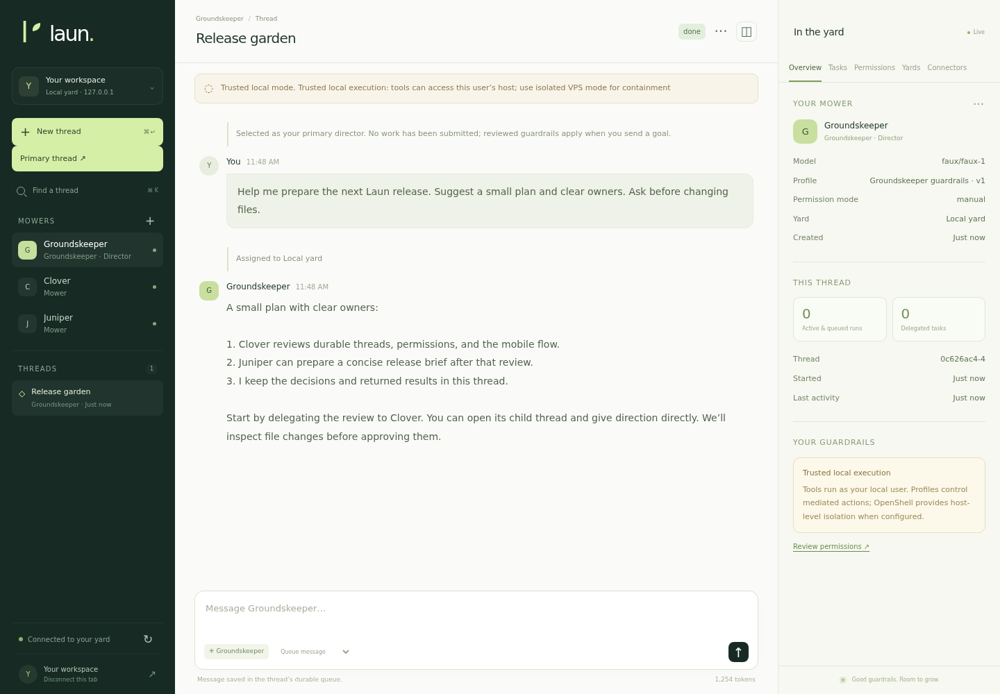
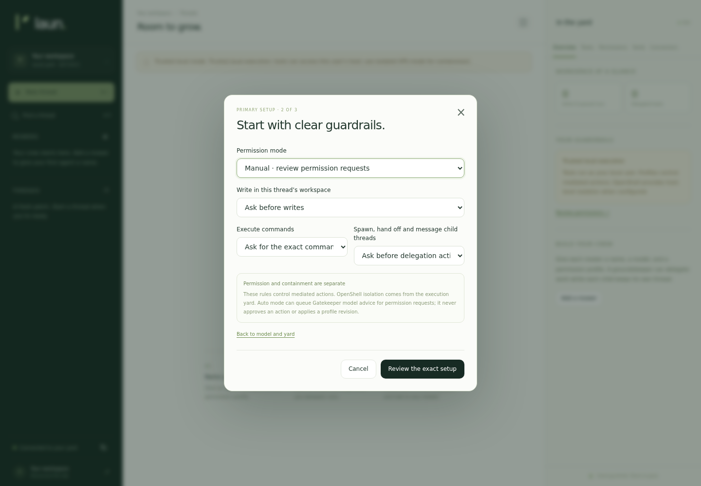
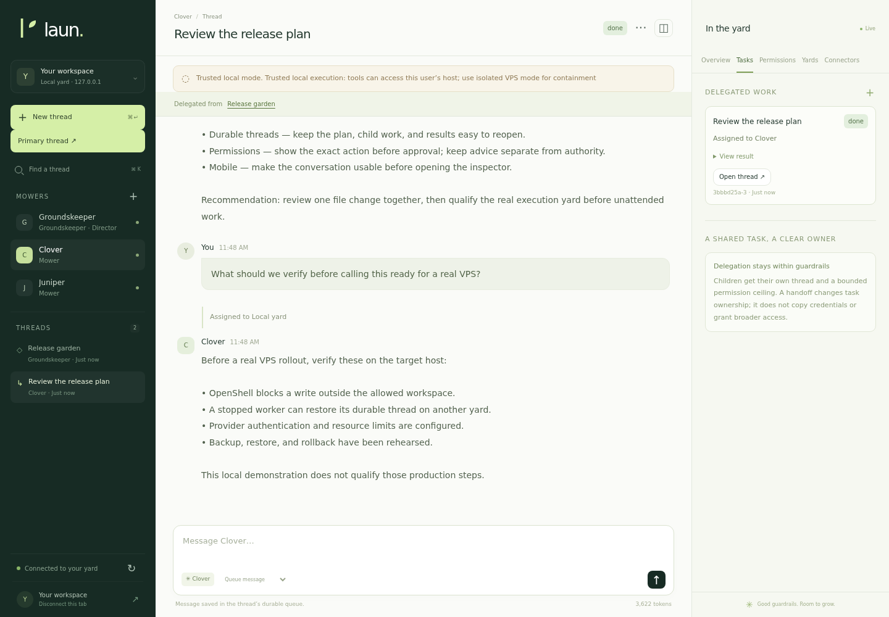
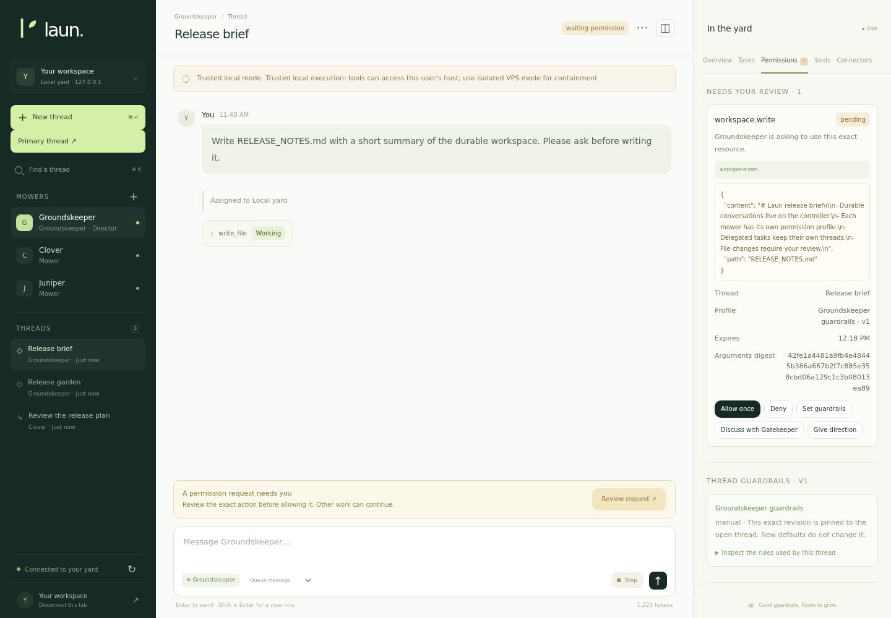
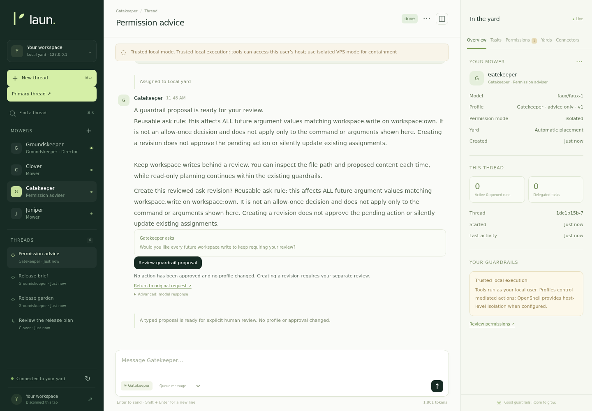
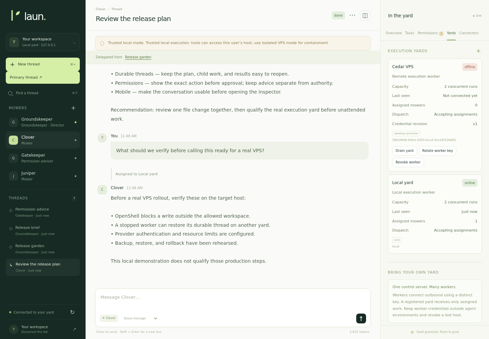
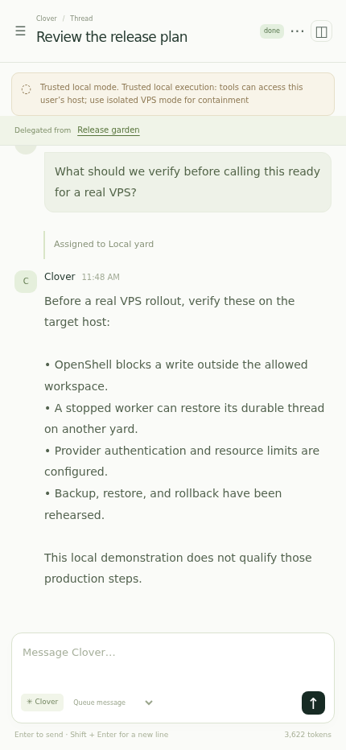

# Try Laun

These walkthroughs run locally without provider credentials. The screenshots
come from the real web app, controller, permission broker, and pinned Pi Durable
adapter. Model replies are scripted; they demonstrate the workflow rather than
a model's reasoning or the readiness of a production VPS.



Choose a demonstration:

| Run | What it is useful for | State |
| --- | --- | --- |
| `bun run dev:app --demo` | Start the normal local application and send a simple message | Kept in the selected local data directory |
| `bun run demo:scenarios` | Walk through delegation, a real pending file action, and Gatekeeper advice | Disposable; removed when stopped |
| `bun run demo:capture` | Recreate the seven screenshots on this page with actual Chromium | Disposable; only screenshot files remain |

These walkthroughs select the explicit `faux/faux-1` scripted provider and make
no paid model calls. Keep that model selected in the normal application: its
demo flag also permits separately configured real models to be chosen.
The rich scenario and capture fixtures do not use an existing Laun installation,
provider credential file, Telegram account, or remote worker. Their execution
mode is **trusted local**: the permission broker mediates tools, and OpenShell
host containment is not enabled.

## A quick local conversation

From the repository root:

```sh
bun install --frozen-lockfile
demo_dir="$(mktemp -d /tmp/laun-echo.XXXXXX)"
LAUN_LOCAL_DATA="$demo_dir" GATEWAY_PORT=8080 bun run dev:app --demo
```

Open `http://127.0.0.1:8080/app` and use the generated local agent key shown in
your terminal. In primary setup, choose the explicit `faux/faux-1` demo model,
the local yard, and the guardrails you want. Send a short message.

The response identifies itself as a demonstration provider and repeats the
input. This is a connection and conversation demo: it does not script the
file-action and delegation story below. Its data directory remains after
Ctrl-C, so restarting with that same `LAUN_LOCAL_DATA` reopens its saved state.
Use another port if 8080 is already occupied.

## Walk through the crew workflow

```sh
bun run demo:scenarios
# Equivalent: bun apps/gateway/test/demo-fixture.ts
```

The command prints a loopback URL and the path to a private temporary
`access.json`. Open that URL and copy the `key` value from that file into the
login form. The fixture keeps the key out of its logs. Ctrl-C or SIGTERM stops
the fixture and removes its temporary conversations, files, and access file.

Replies in this fixture recognize the exact prompts below. Other prompts get
a short scripted fallback. All thread creation, durable events, profile checks,
tool authorization, and file effects still use the actual application services.

### 1. Choose your primary thread and guardrails

Open the workspace menu and **Set up primary Groundskeeper**. Use these choices:

| Setting | Choice |
| --- | --- |
| Mower | Groundskeeper |
| Primary thread | Release garden |
| Model / yard | `faux/faux-1` / Local yard |
| Permission mode | Manual |
| Workspace writes / commands / delegation | Ask |

Review the exact setup before creating it. Setup itself starts no model run.



Add two mowers, **Clover** and **Juniper**, with the same demo model. Select
**Groundskeeper guardrails · v1** as their permission profile. Sharing that
reviewed profile keeps them within the primary thread's delegation ceiling;
the default starter's write allowance would be broader than this parent's
ask-before-write rule and would be rejected for this delegation.

In **Release garden**, send:

```text
Help me prepare the next Laun release. Suggest a small plan and clear owners. Ask before changing files.
```

Expected: the scripted Groundskeeper suggests owners and a plan. It does not
spawn mowers or delegate work by itself in this walkthrough.

### 2. Delegate a task and speak to its mower

Open **Tasks → Delegate a task**, assign **Clover**, and name it
**Review the release plan**. Use this goal:

```text
Review the release plan. Give me a short checklist for durable threads, exact permissions, and the mobile experience. Return your findings here; do not change files.
```

Expected: a real task and child thread appear. Clover returns its scripted
review, the task settles, and its result is returned to the parent. Open the
child thread and send:

```text
What should we verify before calling this ready for a real VPS?
```

The reply lists target-host checks. This demonstrates direct human interaction
with delegated work; the operator clicked **Delegate task**. It does not claim
autonomous model-driven task creation.



### 3. Inspect an exact action before it runs

Create **Release brief**, owned by **Groundskeeper**, and send:

```text
Write RELEASE_NOTES.md with a short summary of the durable workspace. Please ask before writing it.
```

Open **Permissions**. Expected: the real Pi tool call waits for permission. The
card shows `workspace.write`, the workspace resource, the proposed file path
and content, and its action digest. The file has not been created yet.



### 4. Discuss the guardrail without approving the action

Click **Discuss with Gatekeeper** and submit:

```text
Keep asking before workspace writes. Explain what a reusable guardrail would cover before I decide.
```

Expected: a separate durable Gatekeeper conversation presents a validated
ask-before-write proposal. Its managed profile has no operational rules. The
existing Groundskeeper profile remains unchanged and the file action remains
pending. **Review guardrail proposal** opens a separate human review; merely
reading the advice grants nothing. A reusable rule covers future matching
arguments too, unlike approving one exact action.



Return to the original request. You can **Allow once** to create the file inside
this fixture's temporary thread workspace, or use **Give direction** to deny it
and ask for a replan within the unchanged guardrails. The scripted reply after
resolution does not exercise general autonomous planning.

### 5. Inspect placement and use a small screen

The capture also enrolls **Cedar VPS** through the controller API and leaves it
offline. The **Yards** view distinguishes that enrollment from the ready local
runtime. No SSH connection, VPS installation, or remote execution occurs.



Open the child thread in a narrow browser window. The conversation and composer
remain available; mowers and the inspector use the mobile navigation controls.



## Recreate the screenshots

The capture script starts its own fresh scenario fixture, performs the UI
workflow, checks the pending action and unchanged guardrails, writes the PNGs,
and closes Chromium and the fixture. It does not connect to a running workspace.

```sh
CHROMIUM_PATH=/path/to/chromium bun run demo:capture
# Equivalent: bun apps/gateway/test/capture-demos.ts
```

An installed `/nix/store/*chromium*/bin/chromium` is detected automatically.
Otherwise provide a compatible Chromium executable. Playwright is already an
exact-pinned gateway development dependency; no Node/npm installation or new
runtime dependency is needed. The capture uses headless Chromium with its
browser sandbox disabled for this controlled local fixture.

Images are `1440×1000`, with a `430×932` mobile image, in `docs/images/`:
`workspace-desktop.png`, `setup.png`, `approval.png`, `gatekeeper.png`,
`delegation.png`, `yards.png`, and `workspace-mobile.png`.
`LAUN_DEMO_SHOTS=/tmp/laun-demo-images` selects a different output directory.
The script waits for toast dismissal and never captures login credentials or a
one-time worker-key dialog. For broader regression checks, run the separate
[browser workflow suite](../apps/gateway/test/README.md).

## Move from a demonstration to real operation

Use the [local development guide](local-development.md) for a configured
provider, or the [VPS installation guide](../deploy/remote-setup.md) for an
execution yard. Follow the [CLI guide](cli.md) for worker setup and permission
operations, and [how Laun works](how-it-works.md) for the architecture.
Real provider authentication, OpenShell containment, Telegram delivery, remote
installation, and recovery qualification have separate evidence and limits in
the [core status](core-status.md). These screenshots do not establish any of
those deployment checks.
