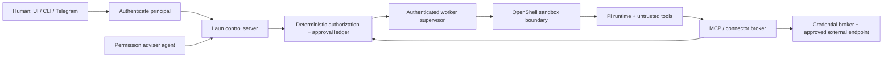

# Permissions, authentication, OpenShell and connectors

Status: proposed architecture and source audit, 2026-11-14. This is a focused code review, not a penetration test or a claim that every vulnerability has been found. No live OpenShell gateway, kernel boundary, external MCP server or VPS was exercised for this document.

## 1. Decision and trust boundaries

Laun owns identity, authorization, approval intent, delegation and audit. OpenShell enforces sandbox filesystem/process/network boundaries and endpoint-bound credential delivery. Pi owns agent execution and conversation mechanics behind a runtime adapter. Neither Pi extension dialogs nor an LLM permission adviser can grant authority by themselves.

Use a small permission module inside the control server first. A separate network permission microservice adds a second availability and consistency problem before there is a need for it. Keep its interface runtime and language independent so it can become a service or Rust implementation later.

The trusted computing base includes the control server, worker supervisor, secret broker, OpenShell gateway and host administrator. A compromised host administrator can access its workers and secrets; a sandbox policy cannot fix that. Treat model output, repository contents, tool descriptions, remote MCP results, Telegram messages and Pi packages as potentially hostile inputs. Third-party Pi extension code executes with agent privileges and must stay inside the sandbox, away from supervisor credentials. Reviewed built-in broker tools can run server-side as trusted application code; installing an extension does not promote it into that registry.

The diagram shows authority flow, not unrestricted network reachability. A runtime may reach only its broker session endpoint and permitted model endpoints. The worker and broker validate server-issued authority on every request.

## 2. Current implementation: useful base and verified gaps

The existing code has useful defenses: SHA-256 hashed high-entropy human keys and timing-safe comparisons, service-only key management, path-shaped session IDs, no shell interpolation for Git/Pi argv, bounded approval waits that deny on timeout, strict YAML unknown-key checking, per-session sandbox names, OpenShell mTLS support, and an environment gate that refuses enabled sandbox mode with neither image nor wrapper. Keep those properties.

| Priority | Observed code / behavior | Missing property and proposed action |
|---|---|---|
| P0 | `apps/executor/src/pi.ts` and `rpc.ts` spawn host Pi with `env: process.env` | Child inherits control credentials such as `GATEWAY_TOKEN` and possibly OpenShell/Goose secrets. Build an explicit agent environment and exclude supervisor credentials. Local host execution still exposes same-user files; describe it as trusted developer mode, not isolation. |
| P0 | `deploy/docker-compose.yml` and `deploy/.env.example` default `OPENSHELL_ENABLED=false` | Violates deploy-on convention. Production install must require a verified sandbox capability and stop on failure. A clearly selected developer configuration may run without it. Never quietly downgrade. |
| P0 | Compose publishes `${EXECUTOR_PORT}:8081` and `${GATEWAY_PORT}:8080` | Both bind all interfaces by default although comments describe executor loopback-only. Remove executor host publishing; bind gateway to loopback for tunnel mode or put only its TLS front door on a public interface. |
| P0 | `apps/gateway/src/index.ts` accepts any valid human key for all sessions, logs, mutation and approval routes | Authentication is not a session ACL. Add principal ownership/workspace membership and resource-scoped authorization before fleet sharing. A bridge must act as the actual user, not the global service identity. |
| P0 | `apps/executor/src/server.ts:checkoutRepo` performs host Git clone before entering the sandbox | HTTP/SSH/git/file/local repo sources can use host network, Git configuration and credentials outside OpenShell. Move acquisition into a constrained fetch stage or sandbox; allowlist protocols and destinations, pin commit, redact credentials in errors, bound size/time and validate local roots with realpath. Blocking literal `..` does not constrain absolute paths. |
| P0 | SDK `0.1.2` is vendored; Docker and installation scripts resolve mutable latest upstream artifacts | SDK/gateway/CLI/image provenance and compatibility are not reproducible. Introduce one reviewed compatibility manifest, artifact digests and explicit upgrade probes. Current upstream release is `v0.1.8`; see section 3. |
| P1 | Compose mounts a writable full operator `~/.pi` and shares `/data` between gateway and executor | Agent-model auth, extension configuration, controller metadata and all thread files need separate trust domains and separate volumes. Worker sees only its assigned thread/artifacts; sandbox receives synthetic credential placeholders. Do not mount operator Pi credentials into production agent sandboxes. |
| P1 | `apps/gateway/src/keys.ts:importKey` reimports `LAUN_KEY` at startup | Revoking the bootstrap key can be undone by restart. Record bootstrap import, reconcile a tombstone/revocation generation, and provide explicit rotation. Corrupt key-store reads currently silently reset state; fail startup and preserve evidence. |
| P1 | `apps/gateway/src/server.ts:publish` logs event persistence errors and continues; replay skips corrupt event lines | A saved/displayed event or lifetime usage count may disappear or change after restart, with cursor and budget consequences. Durable intent, permission decisions and authoritative usage need acknowledged storage before dispatch/acknowledgement; distinguish an incomplete trailing line from corruption of previously committed history. |
| P1 | `apps/executor/src/rpc.ts:onExtensionUi` turns any confirm/select dialog into an approval; select approval chooses the first option | Dialog content does not prove a tool or policy action; a first option could mean allow-always or an unrelated selection. Give dialogs a separate typed answer path. Security approvals bind exact action, parameters, policy revision and run generation. |
| P1 | `apps/gateway/src/server.ts:decideApproval` records decision before async executor delivery | A UI acknowledgement can look like enforcement even when delivery fails. Expose `recorded`, `delivering`, `applied`, `expired`, `superseded` separately; reconcile after disconnect. OpenShell policy approval must be separately confirmed as effective. |
| P1 | `apps/executor/src/server.ts` Goose comments explicitly say adapter permissions were already denied | Later approval acknowledgement cannot revive a denied operation. Report unsupported capability, or implement a real adapter hook; never display an effective grant for an acknowledgement-only path. |
| P1 | `apps/executor/src/notify.ts` infers denials from output and polls rule history | Useful assistance, not an authoritative approval ledger. Bind sandbox identity/workspace/rule version; deduplicate notifications and distinguish unrelated grants. Do not silently retry external mutations after a permission change. |
| P1 | `SandboxReaper.sweep` drops metadata and reports deleted after best-effort `remove`; CLI `remove` suppresses failure | Cleanup success is unverified; failed deletion can leak resources or leave authority active. Persist deleting state, observe completion by sandbox ID, retry boundedly, and keep failures visible. Active runs need leases so a long quiet tool is never reaped. |
| P1 | Telegram `bot.ts` gates `from.id`, keeps latest session in process-global chat map and uses service token | No chat/topic/resource binding, restart durability or workspace roles. Map bot account + chat + topic + user to permitted threads durably; validate callbacks against that binding and current approval state. Group participants must not gain authority through a shared topic. |
| P1 | Telegram approval callback data embeds IDs (`format.ts`); UI keeps human key in localStorage | Use short random approval handles with expiry and server lookup; Telegram callback size is bounded. Add CSP and safe rendering, then move browser authentication to a session mechanism appropriate to the chosen origin/CSRF model. No long-lived service token in browser storage. |
| P1 | No centralized MCP catalog/credential/authorization implementation appears in `apps` or `packages` | OpenShell's ability to inspect MCP is not a Laun connector system. Add a broker and tool catalog; distinguish ACP runtime protocol (`packages/acp`) from MCP tool access. |
| P2 | Template string substitution and hand-maintained schema validation in `packages/policy` | Validate variable values as typed hosts/paths before YAML rendering, avoid schema growth by guesswork, compare fixtures against the pinned upstream validator, and expose whether validation is local syntax or live enforcement. Secret pattern scanning is best effort, not proof of secret absence. |
| P2 | `connectSandboxSurface` accepts HTTP and optional insecure TLS without deployment policy | Keep explicit local developer exceptions; production rejects remote plaintext/insecure transport and embedded URL credentials, uses authenticated worker identities and rotates credentials. |

Pi CLI tool selection also needs explicit qualification: v1.5.2 documents that selecting `--tools` alone leaves MCP tools callable through codemode. The adapter must mediate these paths or disable them with the supported MCP/extension/project-resource controls; a reduced built-in tool list is insufficient. [Pinned Pi CLI documentation](https://github.com/earendil-works/pi/blob/v1.5.2/packages/coding-agent/docs/cli.md)

File references describe the inspected baseline; implementation phases may resolve selected rows. Track resolution in the main design status document rather than silently deleting historical evidence.

First containment implementation: host JSON/RPC Pi children now strip reserved controller environment namespaces and startup hooks; model/provider and Pi variables remain available for login compatibility. Repository Git acquisition gets only platform/transport variables, no controller/model keys, no inherited Git environment overrides, no interactive prompts, and disabled system/global Git config. This intentionally stops implicit host credential-helper/hook/filter configuration; use explicitly configured SSH-agent access for private acquisition until a credential broker exists. Sandbox CLI transport retains its trusted supervisor environment because that authenticates OpenShell and is not forwarded as the sandbox process environment. A generic legacy executable prefix receives the filtered host-agent environment. None of this prevents same-user host file access or constrains Git destinations; production sandbox admission remains required.

Key-store containment: malformed/unreadable records now stop startup rather than resetting credentials; missing files still initialize fresh. The legacy array format remains readable, with additive `revokedAt` tombstones. A revoked bootstrap identity stays revoked after restart or same-ID secret replacement; rotation requires minting a new identity. Key mutations update memory only after atomic-file replacement succeeds. Independent runtime-agent review found no blocker and reran 14 key/auth tests successfully. This prevents write-failure divergence but does not add multiple-writer coordination or an fsync-backed transactional database. Old gateway binaries ignore `revokedAt`; rollback after revocations requires explicit credential-store migration/rotation rather than simply launching an older image against these records.

## 3. Verified OpenShell API reality

Sources were inspected on 2026-11-14. GitHub's latest-release endpoint reported **v0.1.8**, published **2026-11-10**. Laun currently vendors **@nvidia/openshell-sdk 0.1.2**. Do not interpret the version difference alone as proof of incompatibility: qualify a same-release SDK/gateway/CLI/image combination before updating production. Latest-at-a-date is an observation, not a floating dependency policy. [Release v0.1.8](https://github.com/NVIDIA/OpenShell/releases/tag/v0.1.8)

The v0.1.8 TypeScript SDK supports sandbox lifecycle, streaming and interactive exec, scoped clients, sandbox templates and raw generated RPC access. Its curated provider surface includes operator-only credential export; provider CRUD/profile helpers remain uncurated. The SDK does not install the CLI or expose a general file-transfer RPC. Existing lifecycle-via-CLI plus streaming-via-SDK integration is defensible while those gaps remain; it needs one configuration/identity and one compatibility test matrix. [Pinned SDK README](https://github.com/NVIDIA/OpenShell/blob/v0.1.8/sdk/typescript/README.md)

Deletion now has typed outcomes: accepted does not mean gone, and completion observation must fence the original sandbox identity. Mutation retries need stable request IDs where supported; an uncertain accepted operation must be reconciled before retry. Exec output cannot be recovered merely by retrying an admitted exec. Persist these distinctions in the worker model. [Pinned migration guide](https://github.com/NVIDIA/OpenShell/blob/v0.1.8/docs/upgrade/0-1-0.mdx)

Policy filesystem/Landlock/process settings belong at sandbox creation; scoped SDK policy changes cannot introduce them later. Changes in these fields require a controlled stop/recreate/migrate workflow, not an optimistic hot grant. Upstream policy schema and scoped SDK constraints must both be honored. Require Landlock hard enforcement in production and probe the actual host. An OpenShell YAML file passing local tests proves neither kernel support nor applied policy. [Pinned policy schema](https://github.com/NVIDIA/OpenShell/blob/v0.1.8/docs/how-it-works/policies/schema.mdx)

MCP endpoint inspection is revision-aware, including tool name and method restrictions; newer revisions can differ from the local validator's hardcoded list. Use the revision intersection of client, broker/server and pinned OpenShell. Never “fix” a version mismatch by removing inspection or granting wildcard tools. Credential placeholders/injection belong to the provider boundary, and operator credential export must remain inaccessible to mowers. [Pinned MCP policy reference](https://github.com/NVIDIA/OpenShell/blob/v0.1.8/docs/how-it-works/policies/schema.mdx)

The upstream README now describes a move toward `ai-openshell` under CNCF. Treat namespace movement as a supply-chain tracking item; keep releases and artifact origins explicit. [Upstream README](https://github.com/NVIDIA/OpenShell/blob/main/README.md)

## 4. Permission profiles and deterministic evaluation

All wire records and discriminated unions belong in `packages/protocol`. Implement evaluator mechanics in `packages/policy`, with no Pi SDK types outside its adapter. A profile is an immutable revision owned by a workspace, with a label, creator, rationale, expiry/default mode, grant rules and explicit deny rules. Sharing a profile shares rules, not credentials or the source mower's authority. Binding it to another mower requires authorization and a fresh scope intersection.

A principal is a human, connector identity, mower or service. A mower has an identity and a default profile binding. Each thread captures its profile revision; each run captures the effective revision and delegated budget. Record policy revisions as content hashes with opaque IDs; do not rely on mutable display names. A running thread does not silently receive edits to the profile called “developer.” Explicit revocation and stricter workspace policy take effect immediately; ordinary profile improvements apply to new runs or explicitly rebased existing runs.

Effective authority is the **intersection** of workspace/host limits, mower profile, thread restrictions, parent delegation, connector grants and the chosen enforcement capabilities. Explicit denies win. A child cannot exceed any ancestor's authority, remaining spend, remaining tool-call quota, maximum lifetime or allowed hosts. Directors get orchestration permissions through the same rules; they are not superusers.

Model capabilities as operations on typed resources, for example:

- `thread.read`, `thread.message`, `thread.spawn`, `thread.delegate`, `thread.cancel` over specific workspace/mower/thread scopes.
- `workspace.read`, `workspace.write`, `process.execute` over declared sandbox mounts, never arbitrary host paths.
- `network.request` over host + port + scheme + method/path scope; exact hosts first.
- `connector.tool.call` over connector instance, server version, tool and normalized argument constraints.
- `artifact.publish`, `message.send`, `credential.use`, `profile.bind` and `profile.propose` as distinct capabilities.

Do not treat an interpreter/command-name allowlist as semantic command safety. A permitted shell can write files, spawn programs and call the network; sandbox enforcement and mediated external actions remain necessary. Likewise read access to sensitive data plus send access can leak it. Connectors therefore need destination and data scope, not only tool names.

Normalize resources before evaluation and again immediately before use: real paths and mount IDs, normalized origin/port, resolved destination class, normalized connector arguments, immutable artifact digest. Reject unknown operations, malformed selectors, mixed workspace identities, traversal, path alias ambiguity and unsupported constraint kinds. Deny-by-default must support empty network/write/process capability sets; legacy template validators that demand a nonempty allowlist cannot define the new permission semantics.

Initial evaluator results: `allow`, `deny`, `ask` with stable reason codes and matched rule IDs. Policy service outage, unknown profile, stale revision, expired grant, missing identity or worker capability mismatch denies the action. Distinguish a denied action from a failed tool so the agent can replan without falsely reporting completion.

## 5. Auto mode: an adviser inside an authorized envelope

Auto mode is a dedicated permission adviser agent with its own durable thread and a minimal profile. It can explain a request, ask about preferences and propose a profile change. It cannot approve its own capabilities, mutate the policy store, read credential values or impersonate the user. All suggestions are untrusted inputs to the deterministic evaluator.

Use three named modes:

| Mode | Behavior |
|---|---|
| `isolated` | Run within existing allow rules. Explicit ask rules become deny; no permission request opens from the evaluator. |
| `manual` | Explicit ask rules can create a narrow request for the user. No new authority until an authorized answer is durably applied. |
| `auto` (within guardrails) | Existing user-approved allow rules authorize matching requests. Ask rules remain ask; the adviser handles dialogue and proposals. Authority never expands because the adviser is confident. |

An unconfigured operation denies in every mode. The adviser may separately propose a reviewed profile revision; a missing rule never becomes an implicit ask or allow. These identifiers match the initial kernel and control-plane design.

For each denial the scheduler can continue independent tasks, ask the mower to produce a patch/draft, select an alternative destination already allowed, or park/stop the dependent work. Replanning is permitted only within the same restrictions. Retrying through a different tool, child mower, host, uninspected endpoint or newly installed plugin does not remove the denied resource restriction. Repeated equivalent denials are deduplicated and rate limited.

A minimum starting profile grants model access, per-thread workspace read/write and bounded local execution inside a sandbox; connectors start unbound, external writes denied, spawning limited by count/depth/cost, privileged host access absent. Local-only analysis can use no external network except the model route. Users may select a reusable template, inspect its human-readable capabilities and refine it over time.

A feedback answer may create an allow-once action grant, a thread-duration grant, or a new reusable profile revision. Default to the narrowest suggested scope. Broader durable changes show the difference, affected mowers and credential/destination consequences. Store who answered and through which authenticated channel. Inherited Telegram messages, quoted text or model-generated “user said yes” do not constitute consent.

## 6. Approval transaction and revocation

An approval request binds: request ID, principal, workspace, mower, thread, run ID/generation, operation, normalized resource/argument digest, policy revision, delegated scope, exact side-effect intent, created time and expiry. Store display-safe details separately from secrets. Buttons show the action and destination; a generic extension confirmation is not sufficient proof.

State transitions: `pending -> denied | expired | approved -> applying -> effective | failed | superseded`. A durable decision is unique per request; concurrent opposing decisions use compare-and-swap. Retried identical decisions return the existing result. The executor consumes a short-lived action grant exactly once, or uses a connector idempotency key for a retryable external mutation. No claim of exactly-once external side effects when the downstream API cannot supply it.

Before executing, recheck current denies/revocation, policy revision, run generation, worker lease and action digest. An already pending external API call may have committed even if cancellation or revocation arrives. Record uncertain outcome, reconcile remotely and report that limitation. Never make an optimistic duplicate call to “make sure.”

Revocation cuts new tool calls and delegation immediately, invalidates pending grants, pushes cancellation to affected runs, rotates/revokes broker sessions, and reconciles OpenShell policy/provider attachment. Existing network connections or in-flight external operations may need termination/recreation; define the observed completion boundary rather than claiming instant rollback. Approval expires on deletion, relevant profile rebase, run replacement or user revocation.

## 7. MCP, plugins and secrets

Use a centralized connector registry and broker. One connector instance binds a workspace owner, endpoint/transport, credential reference, versioned discovered tool schemas, approved scopes, timeout/rate limits, audit classification and optional OAuth lifecycle. A plugin packages prompts, code or connector declarations; installation does not imply execution or credential access. Pi packages/extensions are code and require separate provenance and sandbox execution policy.

Before exposing a tool, normalize its name under a stable connector namespace and pin the schema digest. Re-discovery that changes a schema, endpoint or tool identity requires revalidation; a server cannot switch `read_issue` into arbitrary execution under an old approval. Treat MCP descriptions and tool results as data, never policy instructions. Restrict sampling, roots, elicitation, resource subscriptions and server-initiated requests explicitly rather than assuming `tools/call` is the whole protocol.

For each tool call: authenticate the run session, authorize exact operation/arguments, reserve budget, acquire a scoped credential in broker memory, call the approved server with deadline/idempotency, redact structured audit output, then return the result. The runtime receives tool results and opaque handles, never refresh tokens or OpenShell operator certificates. Apply response byte limits and separate large artifacts from transcripts.

Remote MCP: HTTPS, approved origins, negotiated revision, redirect reauthorization, DNS/IP checks and no metadata/private control-network reachability by default. Stdio MCP: separate sandbox process with minimal environment and declared filesystem/network access; it must not inherit the broker's own credentials. Do not start arbitrary plugin-provided commands on the controller. OAuth: bind state/PKCE, owner, redirect URI, scopes and refresh-token rotation; isolate credentials between connector accounts and workspaces. Local service development can begin with explicitly configured static connector instances before OAuth UI.

Persist only references and metadata in thread/session/event records. Secrets live in a dedicated credential store with restrictive access, encryption/backups and rotation policy, or in OpenShell's provider store. Redaction at event ingress is defense in depth, not a guarantee: malicious tools can transform a secret. Avoid giving secret values to the model in the first place. Retention/deletion must include artifacts, connector caches, backups and audit access rules.

## 8. Worker and VPS deployment

A host registers using a one-time enrollment credential, then obtains its own revocable identity and reports runtime versions, enforcement capabilities, mounts and capacity. Avoid SSH credentials in agent sessions. Initial worker connectivity should use a user-controlled SSH tunnel or outbound authenticated connection; no public unauthenticated executor. The same control-server API must support local-only, local-controller/remote-worker and co-located VPS installations.

Do not expose OpenShell admin credentials to mowers or accept arbitrary `rawSpec`/driver configuration from an agent. Only the trusted worker constructs sandbox requests from validated profile bindings. Host-specific path/certificate configuration must be explicit and portable; remove hardcoded `/home/ubuntu` assumptions. Local paths selected by a user are controller configuration, not model-selected filesystem authority.

Production preflight must verify pinned versions/digests, trust roots/auth, protected ports, non-root agent identity, Landlock enforcement, volume separation, provider attachment, model-only egress, forbidden metadata/control-service access and a full durable-thread restart. Failure stops activation and identifies the failed check; it does not rewrite `OPENSHELL_ENABLED=false`. Back up controller metadata, Pi thread files, artifacts and OpenShell credential encryption material with separate access and tested restoration.

Filesystem/process changes require snapshot + stop + recreated sandbox + restore + verified boundary + new lease. Keep the previous stopped sandbox until cutover is verified, then delete by identity and confirm. Bound CPU, memory, process count, disk, log bytes, concurrent mowers, child depth and spend. A stopped sandbox is not an archived durable thread: cleanup must never remove the only transcript or unexported work.

## 9. Implementation sequence and acceptance checks

| Slice | Deliverable | Exit evidence |
|---|---|---|
| S0: contain existing risks | Explicit child environment, protected compose topology, production preflight behavior, reproducible compatibility manifest | Fake Pi prints no control secret; production refuses absent sandbox configuration; compose renders protected ingress; package/typecheck/test checks pass. |
| S1: pure policy foundation | Protocol-owned immutable profile and action types; deterministic evaluator; delegation intersection | Unknown capability fails closed; deny wins; empty scopes work; malformed rules rejected; child cannot expand scope; modes never broaden grants. This slice alone does not secure live execution until S3. |
| S2: authorization + ledger | Principals, workspace/thread ACLs, durable revision and approval records, revocation | Two users cannot read/approve each other's threads; restart preserves pending decision; concurrent answers have one winner; stale generation/digest/expiry fails. |
| S3: real runtime enforcement | Trusted adapter gate, sandbox profile compiler, broker session binding, production host probes | Attempt direct shell/network/child bypass; secrets remain inaccessible; tool refuses stale action grant; actual VPS denial probes and known allowed paths pass. |
| S4: connectors | Registry + one read-only MCP connector, then one externally mutating connector | Schema mutation triggers revalidation; redirects/private endpoints denied; token refresh stays private; duplicate callback causes one reconciled mutation. |
| S5: adviser and sharing | Permission adviser thread, narrow diff UX, per-mower binding and reusable revisions | Injected tool text cannot authorize; approve-once stays once; a shared profile carries no credentials; one mower's denial cannot be bypassed through another. |
| S6: operational qualification | Upgrade/restore/rotation/reaper reconciliation, host enrollment + revocation | Kill processes between each transaction step; partition broker/worker; expire auth; lose disk; restore backup; same-name sandbox replacement never receives an old approval/deletion. |

Minimum adversarial matrix: prompt injection in tool/README, unexpected Pi extension, stolen human key, revoked bootstrap restart, forged Telegram callback, wrong chat/topic, duplicate update delivery, stale UI, simultaneous profile edits, denial during child spawn, budget exhaustion race, sandbox name reuse, kernel unsupported, malformed YAML, poisoned DNS, IPv4/IPv6 metadata destinations, URL userinfo/redirects, Git source local/file/SSH, output flooding, disk full, crash between approval and action, external API timeout after commit, and loss of the only durable session copy.

## 10. Review disposition

Architecture choices needing explicit qualification: OpenShell's exact supported MCP revision set and static-policy update semantics must be verified against the selected release, not guessed from moving documentation. Current local tests mostly prove translation/control-flow behavior; production security acceptance requires the real host probes above. Multi-user/public deployment remains out of scope until S2/S3 complete; the current shared-key code is a single-operator base.

Independent cross-review by the product/connectors agent found the adviser and profile-sharing boundaries coherent and requested consistent mode names and deny behavior. The correction above aligns `isolated`/`manual`/`auto` with the control-plane kernel and makes missing-rule deny explicit. The runtime reviewer independently agreed with the authority split, reviewed environment containment without a blocking finding, and requested distinguishing third-party extensions from trusted built-ins; that distinction is now explicit. Security review of the control-plane section separately required deny-first delegation across duplicate rules, workspace binding and ancestor authorization when grants turn ask into allow. Kernel implementation review found a property-enumeration gap in grant/action binding; fixed required-field comparison and an inherited-property regression test resolved it, and the fix was reviewed again. Remaining runtime qualification items are recorded above. Any implementation of S1 must be labeled a foundation until gateway/worker/broker integration actually uses it. A pure evaluator existing in the repository must never be described as the production permission boundary.
