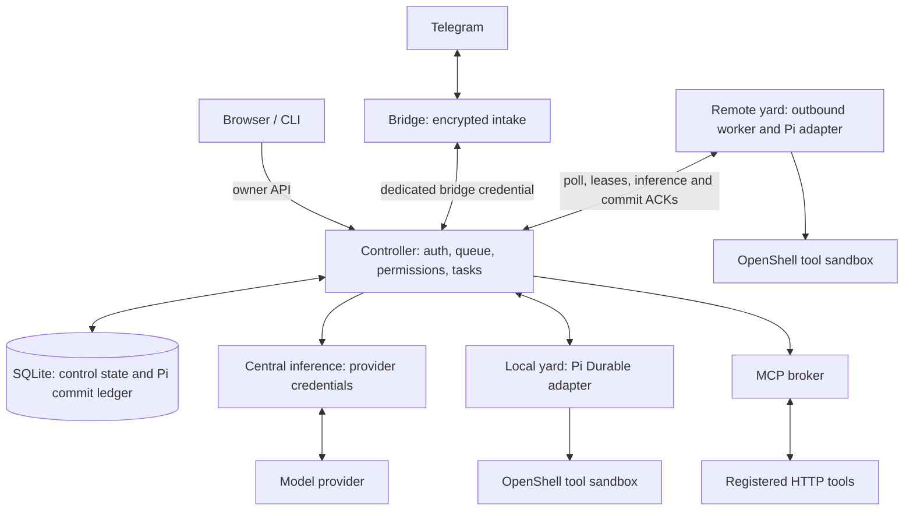

# How Laun works

Laun turns a conversation into durable work performed by a named crew of
agents. You talk to a director, inspect its child threads, and decide what
actions are permitted. The controller keeps the conversation, queue and
permission decisions; execution can happen beside it or on another machine.

Start with the [demos and screenshots](demos.md) for the visible workflow.
Use the [CLI guide](cli.md) for commands and [core status](core-status.md) for
the current qualification record. This guide describes the v2 implementation;
the older session/executor API is an explicitly enabled compatibility path.

## The names describe different things

| Term | What it means |
| --- | --- |
| **Mower** | An agent identity with a name, purpose, model and default permission profile. One mower can have several threads. Its name is not a permission grant. |
| **Groundskeeper** | The primary director mower and its top-level thread. It coordinates work using the same constrained tools as other mowers. |
| **Thread** | A durable conversation with a pinned profile revision, queued inputs, history and placement. Closing your browser does not delete or stop it. |
| **Run** | One accepted input being processed. Its model and mower instructions are snapshotted when the input is admitted. |
| **Attempt / generation** | The current execution claim on a run. A newer generation makes an older worker's events and privileged requests stale. |
| **Task** | A delegation record connecting a parent thread to work assigned to a child. Handoff can change its recipient while retaining the task identity. |
| **Yard** | An execution worker with its own identity, capacity and state directory. It can share a machine with the controller or run on a different VPS. |
| **Gatekeeper** | A separate advice-only mower that discusses permission requests and proposes guardrails. It cannot grant itself or another mower authority. |

These records and the runtime-neutral `AgentRuntime` interface live in
[the shared control protocol](../packages/protocol/src/control.ts). Pi-specific
types stay inside the runtime adapter.

## The controller, harness and sandbox have separate jobs



The **controller** owns user identity, admission, permissions, scheduling and
durable server state. The browser and CLI use `/api/v2`; the gateway serves the
browser at `/app`. See [the gateway entry point](../apps/gateway/src/index.ts),
[HTTP API](../packages/control/src/http.ts) and
[control service](../packages/control/src/service.ts).

**Pi Durable 1.5.2** supplies the conversation and agent scheduler: model turns,
tool tasks, persisted submissions and observations. Laun installs its trusted
tool registry and wraps Pi storage, inference and tool execution. Repository
extensions do not become executable harness plugins automatically. The
[runtime adapter](../packages/runtime/src/index.ts) is the boundary between Pi
and the rest of Laun.

**OpenShell 0.1.8** confines tool processes and files when isolation is enabled.
The trusted controller/worker and Pi harness remain outside that tool sandbox.
OpenShell does not decide a user's Laun profile, and a model instruction cannot
change either layer. Laun checks permissions before dispatch; OpenShell enforces
the supported operating-system ceiling during execution.

## One controller, several possible placements

You can run everything locally, put the controller and its local yard on one
VPS, or keep the controller on one machine and enroll remote yards elsewhere.
Several yards can share a physical machine if each has its own credential and
state directory. A yard is not another independent controller.

Remote yards connect **outbound** to the controller. They poll for jobs and
renew their leases; they do not need a public worker HTTP listener. The
controller selects compatible, accepting capacity. Draining a yard stops new
dispatch while preserving queued affinity; it does not automatically move
threads or prove that existing processes stopped.

Model inference uses the controller's credentials by default for both local
and remote execution. A remote yard receives a proxy for the run's selected
model, not a raw provider key. Explicit operator-managed local inference on a
remote yard is a separate option and requires credentials on that yard.

Execution is also an explicit choice:

| Execution choice | Boundary |
| --- | --- |
| OpenShell enabled | Tools run in the verified sandbox. Failed policy, identity or resource probes stop admission; there is no host fallback. |
| Explicit trusted local mode | Tools still need controller permission, but an allowed general command has the host user's filesystem and network authority. |
| Neither configured | The controller can manage records and dispatch to remote yards; it cannot execute local work. |

OpenShell guests use a non-root user, a hard filesystem ceiling and no generic
command network egress. CPU and memory default to 2 CPUs and 1 GiB and are
verified against the guest's actual cgroup limits. A profile's network allow
does not open a socket from a shell: supported external tool traffic goes
through the MCP broker. See [supported permission boundaries](permissions-boundaries.md),
[worker configuration](../apps/worker/src/config.ts) and
[OpenShell execution](../packages/runtime/src/openshell.ts).

## From a message to an action

The controller stores a submitted message and its request receipt before
acknowledging it. Retrying the same request ID and payload returns the same
admitted work; changing the payload under that ID is a conflict. Inputs follow
a durable FIFO queue, with one active writer per thread. Different threads can
run concurrently within yard and installation capacity.

```mermaid
sequenceDiagram
    actor Owner
    participant Client as App / CLI
    participant Control as Controller
    participant Store as Durable store
    participant Yard as Yard / Pi
    Owner->>Client: Send a goal
    Client->>Control: Message and stable request ID
    Control->>Store: Commit input, receipt and queued run
    Control-->>Client: Run ID and queued status
    Yard->>Control: Claim work
    Control->>Store: Bind yard, generation and lease
    Control-->>Yard: Admitted run
    Yard->>Control: Authorize tool and exact arguments
    alt Missing rule or explicit deny
        Control-->>Yard: Refuse action
    else Explicit allow
        Control-->>Yard: Permit current action
    else Ask
        Control->>Store: Persist pending approval
        Control-->>Client: Show action preview
        Owner->>Client: Allow once or deny with feedback
        Client->>Control: Decision
        Control->>Store: Recheck decision; consume only if approved
        Control-->>Yard: Permit or refuse
    end
    opt Action is permitted and run remains current
        Yard->>Yard: Execute through selected backend
        Yard->>Control: Persist progress and result
    end
```

An accepted message is not a completed run, and a saved approval is not proof
that its tool executed. The controller rechecks current authority before using
an approval. Denial grants no alternative authority: shells, children and
connectors still face their respective checks. Other independent threads can continue.
Busy input currently supports queued follow-up or Stop; immediate steering is
not advertised by the v2 runtime.

## Identity and permission decisions

A human key maps to a stable **owner principal**. Mowers, threads, profiles,
tasks and connections belong to that principal. A replacement key can retain
the owner identity; creating an unrelated key creates another owner. Yard keys
and the bridge credential have different roles and cannot impersonate a human
by supplying an owner header.

Revocation is checked when admitting a request. A key revoked while its JSON
body or asynchronous preparation is waiting cannot later approve or create
work through that cached identity. Work and decisions already durably admitted
remain owner decisions; key rotation does not cancel them. Use explicit Stop
or profile revocation for that purpose. See
[human authentication](../apps/gateway/src/control-auth.ts) and
[credential storage](../apps/gateway/src/keys.ts).

Profiles contain exact operation/resource rules with `allow`, `ask` or `deny`.
For example, `workspace.write` on `workspace:own` describes the thread workspace
capability, not a path glob or a command-string filter. Missing rules deny.
Explicit denials win, including ancestor-thread ceilings. General commands
also require workspace read and write authority because they can do both.

| Profile mode | What happens to an `ask` rule |
| --- | --- |
| `manual` | The action waits for a human decision. |
| `auto` | The action remains gated while Gatekeeper can discuss intent and propose a revision. It does not automatically approve. |
| `isolated` | The request is denied rather than escalating interactively. Explicit allows still work. |

Profile mode and OpenShell isolation are independent settings. Selecting an
`isolated` profile does not turn a trusted local host into a sandbox.

Allow-once approval binds the owner, thread, run generation, operation,
resource, argument digest, profile revision and expiry. It cannot override an
explicit denial. A reusable rule is broader: it covers future arguments for
that operation/resource. Profiles are reusable across an owner's mowers, but
editing one creates a new immutable revision. Existing threads keep their
pinned revision until an explicit reviewed rebase.

Gatekeeper has its own durable thread and an empty, isolated tool profile. It
can explain a request, ask a focused question and produce a validated proposal.
A human reviews any resulting policy change. Denial feedback can ask the source
mower to replan or stop its family; feedback itself grants no authority. The
enforcement points are [policy evaluation](../packages/policy/src/permissions.ts),
[authorization](../packages/control/src/service.ts) and
[Gatekeeper proposal validation](../packages/control/src/adviser.ts).

## Delegating without handing over authority

The director uses mediated `mower_spawn`, `thread_message`, `task_status` and
`task_handoff` tools. Spawn creates durable child/task records with the full
goal. Child authority must fit the parent's ceiling. The human owner can open
and message a child directly; an agent's message tool is scoped to its own
thread and direct children.

A settled child result is admitted once to the parent's queue. Stopped or
archived parents are not automatically revived. Results are untrusted context,
not instructions that grant permission.

Handoff requires live work to be stopped and interrupted work reconciled. It
creates a new child thread for the recipient with the original goal and bounded
context, while retaining the task identity. It does not transfer a running
process or silently adopt broader permissions. See
[orchestration and result routing](../packages/control/src/service.ts) and
[reviewed lifecycle operations](operations-lifecycle.md).

## Durability has three layers

1. **Control records:** SQLite stores input receipts, queues, attempts, tasks,
   approvals, event cursors and delivery state.
2. **Pi commits:** an ordered server ledger stores a seed snapshot and opaque,
   versioned Pi storage commits. Local Pi JSONL files are a rebuildable cache.
3. **Workspace checkpoints:** bounded archives capture session/workspace files
   with hashes and explicit omissions. Workspace changes are not replicated
   by every Pi conversation commit.

```mermaid
sequenceDiagram
    participant Pi as Pi harness
    participant Adapter as Storage adapter
    participant Control as Controller
    participant DB as SQLite
    Pi->>Adapter: Commit conversation/task state
    Adapter->>Adapter: Fsync local JSONL cache
    Adapter->>Control: Append fingerprinted batch at expected sequence
    Control->>Control: Check yard, run, generation and authority
    Control->>DB: Durably commit batch
    alt Server acknowledgement received
        DB-->>Control: Commit complete
        Control-->>Adapter: Accepted sequence
        Adapter-->>Pi: Release commit receipts
        Note over Pi: Further scheduling and visible progress may proceed
    else Acknowledgement missing or uncertain
        Adapter-->>Pi: Stop this writer
        Note over Pi,Control: Reconcile; do not blindly replay effects
    end
```

Both local and remote Pi execution use this acknowledgment boundary. Before
opening a recovered harness, the adapter rebuilds a fixed server ledger head
and verifies record identities and sequences. Unfinished work from a different
run is reconciled while scheduling is paused. Live progress is flushed through
the same commit boundary before it is exposed.

Inference has a separate admission record. The controller selects the exact
snapshotted model, accepts bounded adapter messages/options, records trusted
usage and streams results back. Workers cannot supply provider endpoints,
headers or credentials. A completed model payload is accepted only after the
transport's clean completion confirmation. This central path disables automatic
provider retries; a provider failure never selects the demo model as fallback.

Checkpoints preserve captured artifacts for moves and recovery. Generated
dependencies, caches and quota-exceeding workspace files can be omitted; inspect
`omittedPaths`. A placement change creates a fresh epoch so a returning yard's
old cache or sandbox cannot override a newer server checkpoint. A checkpoint
cannot roll back a remote API call or recover workspace bytes lost before they
were captured. See [Pi storage replication](../packages/runtime/src/durability.ts),
[inference](../packages/control/src/inference.ts),
[checkpoint validation](../packages/storage/src/index.ts) and
[backup recovery](operations-backup.md).

## Disconnections and uncertain effects

Workers renew authenticated leases. Expired, revoked or superseded generations
cannot publish current results or acquire tool authority. Controller/worker
shutdown interrupts active attempts; a missing connection is not proof that
an external process or service stopped. An interrupted attempt blocks later
input until explicit reconciliation and resume or abandon.

MCP discovery pins the endpoint, protocol, credential reference and tool schema.
Changes need rediscovery and current authority. After `tools/call` dispatch,
transport, protocol or tool-error outcomes can leave the external effect
unknown. Laun interrupts the run before another model/tool attempt; it does
not let a model turn an ambiguous result into an automatic retry. See
[the MCP broker](../packages/broker/src/index.ts).

Telegram uses an explicit, expiring account link plus user/group allowlists.
Run one polling bridge per bot token. Each linked user/chat/topic route
independently selects a durable thread; the owner can explicitly select the
same owned thread from multiple routes. The bridge
encrypts incoming updates before acknowledging intake; the controller stores
route and output-delivery receipts. Output is leased, chunked and checked again
before sending. A lost send acknowledgement can mean Telegram already accepted
the message, so an uncertain delivery needs explicit review/retry. Neither
revocation nor Stop can retract a message already sent. See
[controller connector routing](../packages/control/src/connectors.ts),
[bridge intake](../apps/telegram-bridge/src/v2inbox.ts) and
[delivery](../apps/telegram-bridge/src/v2delivery.ts).

## Where data lives

Paths below are relative to configured directories, not necessarily the host
paths shown inside a container. Deployment mounts determine the physical disks.

| Location | Contents |
| --- | --- |
| Controller `DATA_DIR/control.sqlite` and SQLite WAL | Owner-scoped control records, events, Pi ledger, checkpoints and outbox. |
| Controller `DATA_DIR/keys.json` | Human key hashes, stable principals and revocation records. |
| Controller `DATA_DIR/control/threads/<id>/` | Local-yard session cache and work mirror; divergent recovery copies can remain. |
| Yard `LAUN_WORKER_DIR/threads/<id>/` | That yard's per-thread session/work cache and artifact mirror. |
| Yard `LAUN_WORKER_DIR/journal/` | Private event/outcome delivery journals. Positively acknowledged terminal caches can compact; uncertain records remain. |
| OpenShell managed guest | Live isolated workspace and temporary tool files. Captured workspace content is exported through the backend. |
| Bridge `BRIDGE_DATA_DIR/inbox.sqlite` | Encrypted pending incoming updates. Its stable encryption key must be preserved separately. |
| Controller auth files/environment | Provider/MCP credential values and bridge/service secrets, outside agent artifacts. Connection records hold credential references. |

Thread content and exported artifacts may themselves be sensitive. Backups of
the control database do not include every external credential, live guest
volume, bridge queue/key pair, filesystem snapshot or already-sent message.

Persistence has finite bounds. Ledger, checkpoint, event-delivery journal and
bridge-intake limits can stop further admission, and the free-disk reserve
protects storage headroom. These guards are not a complete per-owner disk quota.
See [runtime limits](../packages/runtime/README.md) and
[worker recovery](../apps/worker/README.md) before planning long-lived workloads.

Stop, archive, controller-copy removal and host cleanup are different actions.
Controller purge requires a reviewed digest and an archived, settled leaf.
Host removal requires another owner approval and verifies managed paths,
writer locks and guest identities. Unknown copies remain outstanding. Neither
operation claims secure physical erasure. See [retention](operations-retention.md),
[upgrade/rollback](operations-upgrade.md) and
[passive legacy import](operations-legacy-import.md).

## What the current evidence establishes

The app, real Pi harness, server ledger, workers, permissions and recovery have
local acceptance tests. The packaged controller has also exercised actual
OpenShell mTLS, resource/denial probes, restart, cache-loss recovery and approved
cleanup on a temporary local engine. Browser screenshots use an explicitly
scripted provider; separate bounded real-provider evidence is recorded in
[core status](core-status.md).

An external VPS and a real Telegram account still need their own installation,
network, kernel, certificate and delivery qualification. HTTP MCP tools are the
supported plugin surface. Arbitrary executable plugins, extra chat/runtime
engines, per-command semantic policies, universal external-effect exactly-once
delivery and a Rust port are not implemented by this architecture.
